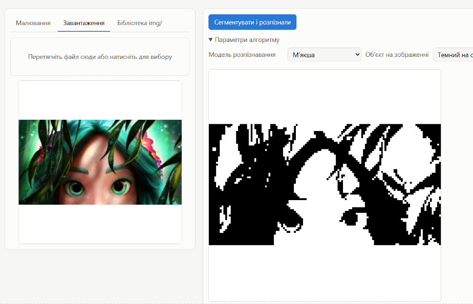
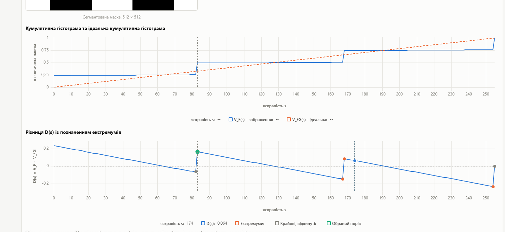

# Розпізнавання фігур з дефектами

Вебзастосунок, який перевіряє геометричну фігуру на зображенні на наявність
дефектів - сторонніх наростів, відростків і заглибин на її контурі. Це
спрощена модель задачі візуального контролю якості: відрізнити деталь
правильної форми від бракованої.

Робота виконана у два кроки, кожен з яких вирішує свою частину задачі:

1. **Де на зображенні фігура?** Класичний алгоритм обробки зображень -
   сегментація за кумулятивною гістограмою. Він сам підбирає поріг
   яскравості, відокремлює об'єкт від фону і зводить його до чорно-білої
   маски 128×128, незалежно від кольору, розміру, повороту й освітлення.
2. **Чи є на ній дефект?** Маска подається у згорткову нейромережу
   (MobileNetV2), навчену на синтетичному наборі правильних і дефектних
   фігур. На виході - ймовірність дефекту.

Такий поділ і є суттю роботи: нейромережа бачить не саму фотографію, а вже
нормалізовану маску, тож їй не треба вчитися на всі можливі фони й кольори -
це бере на себе детермінований алгоритм. Зворотний бік - **якість
розпізнавання впирається в якість сегментації**, і в застосунку це видно
наочно: поріг можна пересунути вручну й одразу побачити, як змінюється
вердикт моделі.

Джерело зображення - малювання просто в браузері, завантажений файл або
готовий зразок із папки `img/`. Усе рахується **локально у браузері**: ані
зображення, ані моделі нікуди не надсилаються, серверної частини немає взагалі.

Застосунок об'єднує результати трьох попередніх лабораторних робіт: інтерфейс
із полотном на Fabric.js та графіками на uPlot, алгоритм сегментації за
кумулятивною гістограмою з вибором і відсіканням екстремумів, і дві навчені
нейромережі для розпізнавання дефектів.

---

## Як працює

```
зображення  →  градації сірого  →  кумулятивна гістограма V(s)
                                          ↓
                          різниця D(s) = V(s) − Vg(s)
                                          ↓
                    екстремуми D(s) → вибір порога s_opt
                                          ↓
              бінаризація → обрізання по фігурі → кадр 128×128
                                          ↓
                        MobileNetV2 (ONNX) → P(дефект)
```

### 1. Сегментація за кумулятивною гістограмою

[js/segmentation/cumulativeHistogramSegmenter.js](js/segmentation/cumulativeHistogramSegmenter.js)

Зображення переводиться у градації сірого (BT.601), для 256 рівнів яскравості
будується кумулятивна гістограма `V(s)` та **ідеальна** кумулятивна гістограма
рівномірного розподілу `Vg(s) = (s+1)/256`. Поріг шукається серед екстремумів
їх різниці `D(s) = V(s) − Vg(s)`.

Екстремуми проходять два фільтри:

- **за виразністю** - сусідні екстремуми одного типу зливаються, пара
  «мінімум–максимум» із перепадом менше `minProminence` відкидається;
- **крайові** - початковий мінімум і кінцевий максимум ігноруються як
  артефакти країв гістограми.

Серед решти беруться лише **вагомі** (не менше 30 % від найбільшого `|D|`),
і залежно від того, темний об'єкт на світлому чи навпаки, обирається перший
або останній із них. Напрямок визначається автоматично - за середньою
яскравістю рамки зображення.

Далі бінаризація за `s_opt`, обрізання по bounding box фігури і масштабування
в кадр 128×128 із **усередненням покриття** (піксель зафарбовується, якщо
його перекрито щонайменше наполовину) - так маска не розсипається при
зменшенні.

### 2. Класифікація дефекту

[js/classifiers/onnxClassifier.js](js/classifiers/onnxClassifier.js)

Маска 128×128 розгортається у тензор `[1, 128, 128, 3]` і подається в
ONNX-модель через `onnxruntime-web` на WASM-бекенді. Вихід - імовірність
дефекту; поріг рішення за замовчуванням **0.8**.

---

## Моделі

Навчання: [train/defect_classifier_colab.ipynb](train/defect_classifier_colab.ipynb)

- **Архітектура** - MobileNetV2 (ваги ImageNet) + GlobalAveragePooling +
  Dense(128, ReLU) + Dropout + Dense(1, sigmoid).
- **Навчання** - два етапи: спершу заморожена основа (Adam 1e-3), потім
  fine-tuning останніх 30 шарів (Adam 1e-5), EarlyStopping за val AUC.
- **Дані** - 6000 синтетичних зразків, згенерованих Pillow: 6 типів фігур
  (квадрат, прямокутник, коло, еліпс, п'ятикутник, шестикутник) із випадковим
  масштабом і поворотом; дефекти трьох типів - `line` (тонкий відросток),
  `bump` (наріст-півколо), `blob` (наріст на ніжці). Рендер із суперсемплінгом
  ×2 і тим самим `fit_to_frame`, що й у застосунку, - тож модель бачить рівно
  те, що віддає сегментатор. Саме з цим повним набором навчено **сувору**
  модель; **м'якша** - з того самого набору без `bump` (див. нижче).
- **Експорт** - `tf2onnx` (opset 15), далі динамічна квантизація
  `quantize_dynamic` до QUInt8.

### Сувора і м'якша модель

Навчено дві моделі - однакова архітектура, однаковий процес навчання,
різниця лише в **навчальному наборі**:

| Модель | Дефекти в наборі | Поведінка |
|---|---|---|
| **Сувора** | `line`, `bump`, `blob` | ловить будь-яке відхилення від ідеальної фігури, зокрема й дрібне |
| **М'якша** | `line`, `blob` (без `bump`) | нерівності контуру вважає нормою, реагує лише на виражені відростки |

`bump` - це наріст-півколо на межі фігури, тобто локальне потовщення контуру.
Саме так виглядає й звичайна нерівність фігури, намальованої від руки, - тому
сувора модель позначала дефектом майже кожен ручний малюнок. Викинувши `bump`
із набору, ми навчили м'якшу модель терпіти таку нерівність: із нею
**можна малювати фігури від руки** і перевіряти саме на справжні дефекти.

Звідси й правило вибору: **сувора** - для рівних, згенерованих або
відсканованих фігур; **м'якша** - для малювання в самому застосунку.

У `models/` лежать чотири файли:

| Файл | Розмір | Опис |
|---|---|---|
| `defect.onnx` | 9.6 МБ | м'якша модель |
| `defect_quant.onnx` | 2.6 МБ | те саме, квантовано |
| `defect_strict.onnx` | 9.6 МБ | сувора модель |
| `defect_strict_quant.onnx` | 2.6 МБ | те саме, квантовано |

---

## Інтерфейс

Три способи задати зображення - вкладки в лівій панелі:

- **Малювання** - полотно на [Fabric.js](https://fabricjs.com/).
  Фігури будуються протяжкою від центру: довжина задає розмір, напрямок -
  поворот (кут прилипає до 15°, з Shift вільний). Готову фігуру можна
  посунути, змасштабувати, докрутити ручкою або видалити. Пензлем
  домальовується дефект, гумкою стирається зайве. Колір фігури довільний -
  сегментатор сам визначає, темний об'єкт на світлому чи навпаки.
- **Завантаження** - drag&drop або вибір файлу.
- **Бібліотека `img/`** - 24 готові зразки, покладені поруч із застосунком.

Права панель показує результат: вердикт, сегментовану маску, вхід нейромережі
та два графіки на [uPlot](https://github.com/leeoniya/uPlot) - кумулятивну
гістограму проти ідеальної і різницю `D(s)` з позначеними екстремумами.

---

## Приклади

### Сегментація довільного зображення

Алгоритм не вимагає геометричної фігури на вході - він працює з будь-яким
зображенням. На фотографії поріг `s_opt` ділить її на темну й світлу частини:



Видно й межу методу: коли на зображенні багато об'єктів різної яскравості,
одного порога замало - маска розпадається на кілька зв'язних областей, і
класифікатор дефекту на такому вході вже не має сенсу. Метод розрахований на
випадок «один об'єкт на однорідному фоні», і саме такі зразки лежать у `img/`.

### Графіки методу і вибір порога вручну



Верхній графік - кумулятивна гістограма зображення `V_F(s)` (синя) проти
ідеальної `V_FG(s)` (помаранчева пунктирна). Кожна сходинка синьої кривої -
це група пікселів однакової яскравості: на прикладі їх дві великі, при `s≈83`
і `s≈167`, тобто зображення має два виражені тони.

Нижній графік - різниця `D(s) = V_F − V_FG`, на якій і шукається поріг.
Позначення:

| Маркер | Що це |
|---|---|
| помаранчевий | екстремум, що пройшов фільтр виразності |
| сірий | крайовий екстремум, відкинутий (початковий мінімум / кінцевий максимум) |
| зелений | обраний поріг `s_opt` |
| вертикальна пунктирна | положення порога на обох графіках |

**Поріг можна задати самому - просто клікнувши по графіку `D(s)`.** Застосунок
одразу пересегментує зображення з цим порогом, перемалює маску і заново
запустить класифікатор; у метриках з'явиться «Вибір порога: вручну, по
графіку». Автоматичний вибір повертається кнопкою «Сегментувати і розпізнати».

Це найкорисніший інструмент для розбору роботи методу: пересуваючи поріг між
сусідніми екстремумами, видно, як фігура то «худне», то злипається з фоном, і
як разом із цим стрибає ймовірність дефекту.

---

## Технології

| | |
|---|---|
| Мова | JavaScript (ES-модулі), без збірки й без фреймворків |
| Полотно | [Fabric.js 6](https://fabricjs.com/) (ESM-збірка в `vendor/`) |
| Графіки | [uPlot](https://github.com/leeoniya/uPlot) |
| Інференс | [onnxruntime-web 1.20](https://onnxruntime.ai/) (WASM), з CDN |
| Навчання | TensorFlow / Keras 3, MobileNetV2, Pillow |
| Конвертація | tf2onnx, onnxruntime.quantization |

Обробка зображень (градації сірого, гістограми, бінаризація, ресемплінг)
написана вручну на `Uint8ClampedArray` / `Float64Array` - без OpenCV.

---

## Запуск

Застосунок **не відкривається подвійним кліком** по `index.html`: браузер
блокує ES-модулі з протоколу `file://` через CORS. Потрібен будь-який
HTTP-сервер:

```bash
python -m http.server 8000
# або
npx serve .
```

далі `http://localhost:8000/`. У VS Code так само підійде розширення
**Live Server**.

Вкладка «Бібліотека img/» читає список файлів із
[img/index.json](img/index.json). Після зміни вмісту `img/` його треба
перегенерувати:

```bash
node tools/build-image-index.mjs
```

---

## Структура

```
index.html                     розмітка
css/styles.css                 стилі
js/
  app.js                       збирання застосунку докупи, сценарій «сегментувати і розпізнати»
  core/imageUtils.js           ImageData ↔ маска ↔ canvas
  segmentation/
    cumulativeHistogramSegmenter.js   метод кумулятивної гістограми
  classifiers/
    onnxClassifier.js          інференс ONNX через onnxruntime-web
  data/sampleGenerator.js      генератор зразків у браузері
  services/
    library.js                 список файлів у img/
    imageFolder.js             запис зразків через File System Access API
  ui/
    sourcePanel.js             вкладки джерела зображення
    board.js                   полотно на Fabric.js
    chart.js                   обгортка uPlot
    gallery.js, tabs.js        галерея та перемикання вкладок
    resultView.js              вердикт, маска, графіки, метрики
vendor/                        fabric.min.mjs, uPlot.esm.js, uPlot.min.css
models/                        4 ONNX-моделі
img/                           зразки + index.json
train/                         ноутбук навчання (Colab)
tools/build-image-index.mjs    перегенерація img/index.json
```

---

## Висновки

**Квантизація майже не коштує точності.** Втрата точності у квантованих
моделей підтвердилася, але виявилася незначною - тож можна сміливо брати
квантовану модель замість повної й отримати застосунок у 3.6 раза легший
(2.6 МБ проти 9.6 МБ) і швидший на старті.

**Поріг сегментації вирішує все.** Чим точніше алгоритм відокремлює фігуру
від фону, тим рівніша виходить маска і тим впевненіше передбачення моделі.
Саме тому в інтерфейсі лишено ручний вибір порога по графіку `D(s)` -
різницю між сусідніми екстремумами добре видно на вердикті.

**Моделі узагальнюють на небачений тип дефекту.** Найцікавіше спостереження
стосується дефектів-заглибин: таких у навчальному наборі не було взагалі
(усі три згенеровані типи - це *надлишок* матеріалу, а не його нестача).
Попри це сувора модель розпізнає заглибини дуже добре, а м'якшій потрібна
помітно більша заглибина, щоб вона визнала фігуру дефектною.
