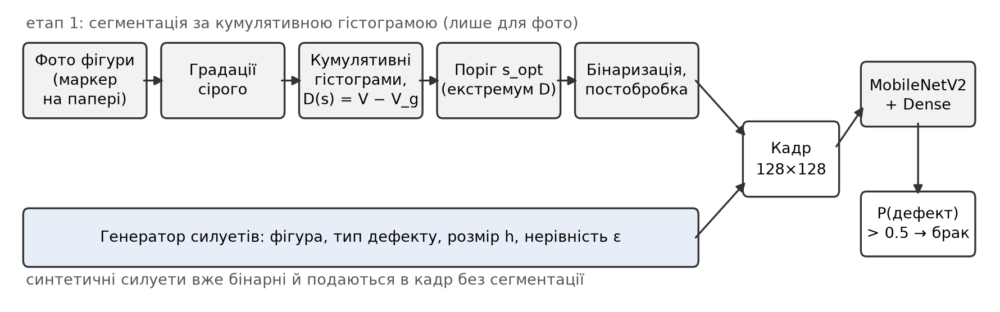
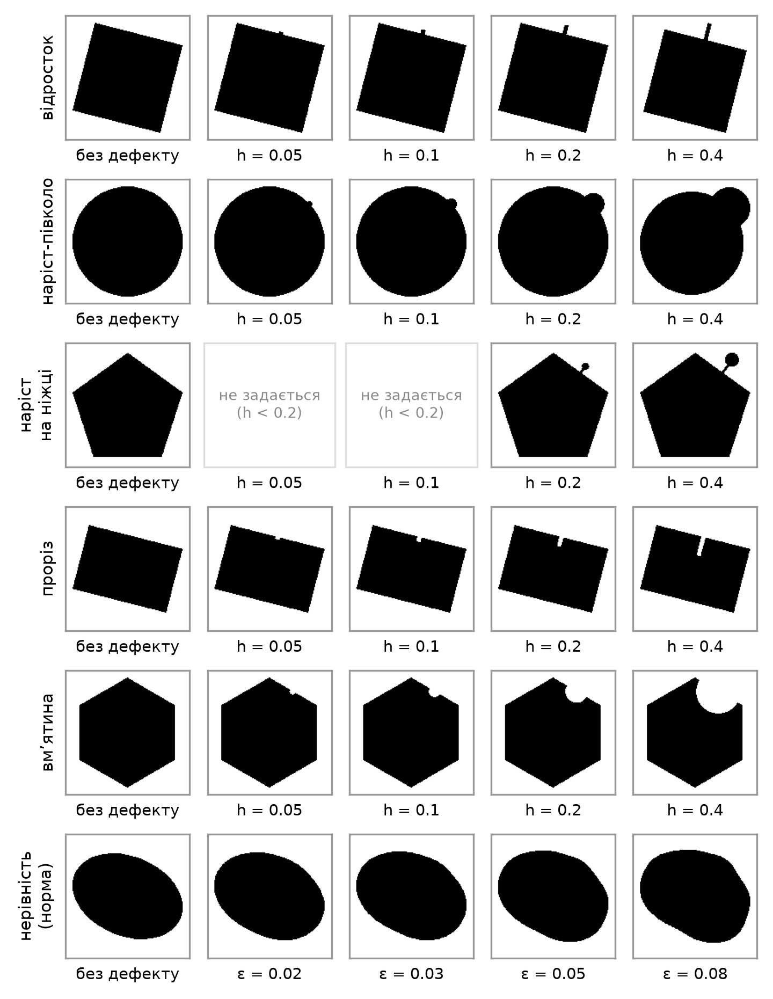
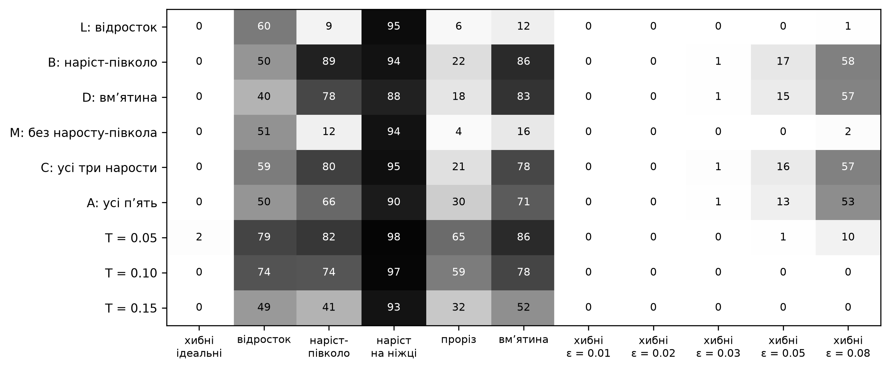
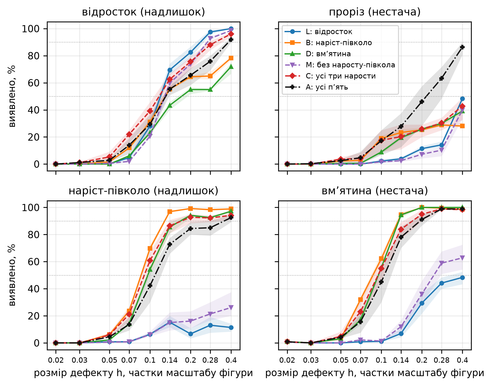
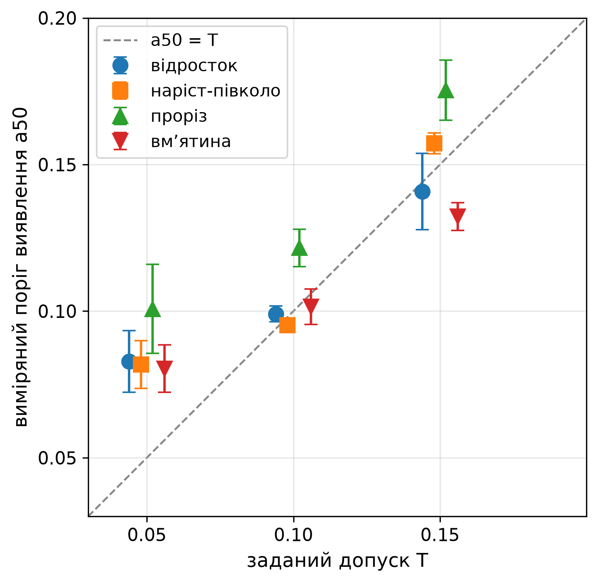
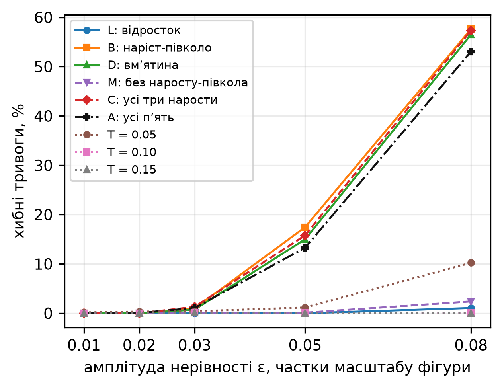
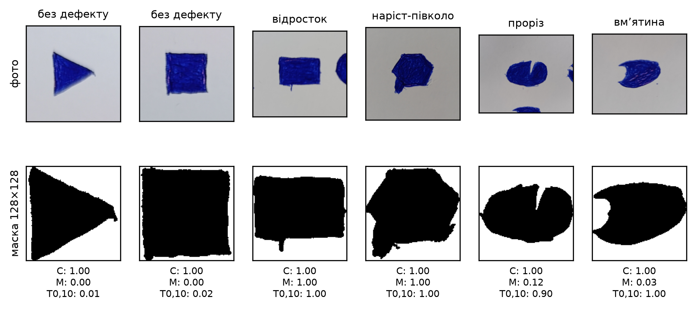

# Вплив синтетичних навчальних даних на чутливість детектора дефектів

## 1. Вступ

Автоматизований візуальний контроль якості дедалі частіше спирається на згорткові нейронні мережі [1, 2]. Для навчання їм потрібні зразки з дефектами, а саме таких зразків на виробництві найменше. Брак трапляється рідко і є різнорідним, тож зібрати достатньо прикладів кожного виду складно [3]. Поширене рішення — синтетичні дефекти, згенеровані штучно або перенесені на зображення норми [4–6].

Генератор синтетичних дефектів, однак, не нейтральний. Вирішуючи, які відхилення і якого розміру віднести до браку, розробник неявно визначає, що модель згодом вважатиме дефектом і наскільки дрібні відхилення помічатиме. Для самонавчальних детекторів аномалій показано, що їхня якість визначається відповідністю синтетичних аномалій справжнім [7]. Тим часом у виробничому контролі чутливість задають явно, допуском: відхилення профілю в межах допуску вважається нормою, поза ним — браком [8]. Нейромережевий детектор такого регулятора не має, і його допуск є побічним наслідком складу навчальних даних.

Щоб дослідити цей вплив кількісно, у роботі побудовано двоетапний детектор дефектів форми за силуетом: зображення сегментується за кумулятивною гістограмою [9, 10], а отримана бінарна маска класифікується мережею MobileNetV2. Детектори однакової архітектури навчено на наборах різного складу й порівняно між собою.

Код генератора, детектора і всіх експериментів відкритий: https://github.com/Shpytchuk-Vasyl/Recognition-of-defective-shapes; детектор також доступний як вебзастосунок: https://shpytchuk-vasyl.github.io/Recognition-of-defective-shapes/.

## 2. Аналіз останніх досліджень і публікацій

Огляд [1] систематизує методи глибокого навчання для виявлення поверхневих дефектів. У роботі [2] показано, що сегментаційна архітектура досягає високої точності вже на кількох десятках дефектних зразків. Набір MVTec AD [3] закріпив постановку, в якій модель навчається лише на бездефектних зразках, а дефекти трапляються тільки під час тестування. У цій постановці поширені методи, що створюють штучні дефекти з нормальних зображень:

- вирізання й вставлення фрагментів (CutPaste [4]);
- накладання сторонніх текстур за масками шуму Перліна (DRAEM [5]);
- природніші, без видимих швів, вставки (NSA [6]).

Мета-аналіз 420 задач [7] показав, що спосіб генерації штучних аномалій діє як гіперпараметр. Якщо він не відповідає справжнім дефектам, якість детектора може навіть погіршитися. Ці роботи оцінюють детектори загальними метриками (AUC) і не відповідають на питання, з якого розміру модель починає помічати дефект.

У неруйнівному контролі здатність методу виявляти дефекти описують кривою ймовірності виявлення (probability of detection, POD), тобто залежністю частки виявлених дефектів від їхнього розміру, та її характерними точками a50 і a90 — розмірами дефекту, які виявляються в 50 % і 90 % випадків [14, 15]. Такий підхід застосовано, зокрема, до нейромережевого детектора дефектів в ультразвукових даних, навченого на штучно доповнених даних [16]. Залежність порога виявлення від складу навчальних даних для детекторів дефектів форми за силуетом, наскільки відомо авторам, не досліджувалася.

Етап сегментації в цій роботі спирається на метод, у якому поріг обирають за різницею кумулятивних гістограм реального і гіпотетичного зображень [9, 10]. На відміну від класичного методу Оцу [11], цей метод дає змогу вибирати поріг серед кількох екстремумів зазначеної різниці. Розподілені кумулятивні гістограми застосовано також для виявлення дефектів поверхонь матеріалів [12] і друкованих плат [13]. У [13] дефекти бінарного зображення плати поділено на дві групи: зайвий і відсутній метал. Цей поділ відповідає осі полярності дефектів, яку використано в цій роботі.

Отже, невирішеною частиною загальної проблеми є, по-перше, відсутність кількісних даних про те, як типи й розміри синтетичних дефектів у навчальному наборі визначають поріг виявлення та перенесення між видами дефектів. По-друге, бракує способу явно задати допуск нейромережевого детектора.

## 3. Мета і завдання дослідження

Мета роботи — встановити, як склад штучного навчального набору визначає чутливість детектора.

Для досягнення мети розв'язано такі завдання:

1. Побудувати генератор силуетів з дефектами (дві полярності і три морфології та з єдиною мірою розміру).
2. Навчити серію детекторів однакової архітектури на наборах різного складу.
3. Для кожного детектора визначити:
   - перенесення між типами дефектів;
   - криві ймовірності виявлення, тобто частку виявлених дефектів залежно від їхнього розміру, і пороги виявлення a50 та a90 — розміри дефекту, які модель знаходить відповідно в 50 % і 90 % випадків;
   - частку хибних тривог на фігурах з природною нерівністю контуру.
4. Перевірити висновки на фотографіях фігур, намальованих від руки.

Перевірити чотири гіпотези:

- **H1.** Модель, навчена лише на наростах, виявляє заглибини тієї самої морфології, оскільки реагує на локальну нерівність контуру, а не на її знак.
- **H2.** Вилучення морфології з навчального набору зсуває криві виявлення обох полярностей цієї морфології в бік більших розмірів.
- **H3.** Якщо відхилення, менші за T, розмічати як норму, то поріг виявлення a50 наближається до T.
- **H4.** Що нижчий поріг виявлення, то більше хибних тривог на природній нерівності контуру.

## 4. Матеріали і методи

### 4.1. Конвеєр розпізнавання

Схему конвеєра наведено на рис. 1.

**Етап 1: сегментація.**

- Кольорове зображення переводиться в градації сірого s ∈ {0, …, 255} за формулою BT.601.
- Будується нормована кумулятивна гістограма V(s) і кумулятивна гістограма гіпотетичного зображення з рівномірним розподілом яскравості V_g(s) = (s + 1)/256 [9].
- Поріг s_opt обирається серед екстремумів різниці D(s) = V(s) − V_g(s):
  1. сусідні екстремуми одного типу зливаються;
  2. пари з перепадом менше 0,002 відкидаються;
  3. початковий мінімум і кінцевий максимум ігноруються як крайові;
  4. з решти залишаються екстремуми, де |D| становить не менше 30 % від найбільшого;
  5. для темного об'єкта на світлому тлі береться перший із них, для світлого — останній. Тип об'єкта визначається за середньою яскравістю рамки зображення.
- Після бінаризації маска обрізається по габаритному прямокутнику фігури і вписується в кадр 128 × 128 з усередненням покриття.

**Постобробка маски для фотографій.** Зберігається найбільша зв'язна область, що не торкається краю кадру, і заповнюються порожнини всередині неї. Потреба в цьому виникла тому, що на фото з нерівним освітленням екстремум D(s), за яким обирається поріг, лежить на початку моди паперу. На синтетичних «фото» з градієнтом освітлення і шумом поріг становив 175–200 при яскравості чорнила близько 40. Через це темніші ділянки паперу й шум потрапляли в маску й розтягували рамку обрізання.

**Синтетичні силуети** вже бінарні, тож сегментація до них не застосовується. Вони вписуються в кадр тим самим способом і одразу подаються на вхід мережі.

**Етап 2: класифікація.** Маска (фігура — 0, тло — 255, три канали) подається в мережу MobileNetV2 [17], попередньо навчену на ImageNet. Над нею розміщено голову GlobalAveragePooling → Dropout(0,3) → Dense(128, ReLU) → Dropout(0,2) → Dense(1, sigmoid). Вихід мережі — імовірність дефекту; поріг рішення 0,5.

*Рис. 1. Схема конвеєра. Сегментація застосовується лише до фотографій; синтетичні силуети подаються в кадр напряму.*

### 4.2. Параметричний генератор силуетів

Генератор будує силует однієї з шести фігур: квадрата, прямокутника, кола, еліпса, п'ятикутника або шестикутника. Масштаб фігури S випадково змінюється в межах ±15 %, кут повороту довільний. Рендеринг виконується з подвійним суперсемплінгом на полотні 512 × 512. Дефект розміщується у випадковій точці контуру по нормалі до нього; на багатокутниках — подалі від вершин. Розглянуто п'ять типів дефектів (табл. 1, рис. 2).

*Таблиця 1. Типи дефектів*

| Дефект | Позначення | Полярність | Морфологія | Розмір h | Діапазон h у навчанні* |
|---|---|---|---|---|---|
| відросток | line | надлишок | видовжений | довжина виступу | [0,35; 0,70] |
| наріст-півколо | bump | надлишок | компактний | радіус | [0,12; 0,22] |
| наріст на ніжці | blob | надлишок | на ніжці | довжина ніжки разом із радіусом наросту | [0,46; 0,77] |
| проріз | slit | нестача | видовжений | глибина | [0,20; 0,45] |
| вм'ятина | dent | нестача | компактний | радіус | [0,12; 0,22] |

\* Для складів L–A (п. 4.3). Діапазони прорізу й вм'ятини дзеркальні до відростка й наросту-півкола. У наборах T розміри задаються допуском.

Розмір дефекту h задається як максимальне відхилення контуру фігури від номінального, віднесене до масштабу фігури S (для кола S — радіус):

$$h = \frac{1}{S}\,\max_{p \in \Gamma} \rho(p, \Gamma_0), \qquad \rho(p, \Gamma_0) = \min_{q \in \Gamma_0} \lVert p - q \rVert, \tag{1}$$

де Γ₀ — номінальний контур фігури (без дефекту), Γ — контур фігури з дефектом, ρ(p, Γ₀) — відстань від точки p до номінального контуру.

Отже, h показує, на яку найбільшу відстань контур відходить від номінального: назовні для наростів і всередину для нестач. Для кожного типу дефекту ця відстань дорівнює величині з табл. 1: довжині виступу, радіусу або глибині. Це аналог допуску профілю лінії [8], де відхилення контуру в межах допуску вважається нормою.

Контрольне вимірювання за формулою (1) на 24 зразках кожного типу показало, що фактичне відхилення відрізняється від заданого не більше ніж на 0,007 S, тобто приблизно на один піксель полотна.

Генератор також моделює природну нерівність контуру — плавне радіальне збурення r(θ) → r(θ) + ε·S·f(θ). Тут f(θ) = Σ a_k cos(kθ + φ_k) для k = 2, …, 8, де a_k ~ N(0, 1)/k, а φ_k — випадкові фази; функцію нормовано так, що max |f| = 1. Така нерівність імітує фігуру, намальовану від руки, і вважається нормою, а не дефектом.

*Рис. 2. Синтетичні силуети. У кожному рядку та сама фігура: без дефекту (перший стовпець) і з дефектом розміру h = 0,05–0,4 у тому самому місці контуру. Останній рядок — нерівність контуру ε, яка вважається нормою. Наріст на ніжці задається лише для h ≥ 0,2. У навчальних і тестових наборах фігура, її масштаб, поворот і місце дефекту випадкові.*

### 4.3. Склад навчальних наборів

Досліджено дев'ять складів навчального набору (табл. 2).

*Таблиця 2. Склади навчальних наборів*

| Позначення | Дефекти в класі «брак» | Призначення |
|---|---|---|
| L | line | лише видовжений надлишок |
| B | bump | лише компактний надлишок |
| D | dent | лише компактна нестача |
| М | line, blob | нарости без компактного |
| С | line, bump, blob | усі нарости |
| A | line, bump, blob, slit, dent | повний набір |
| T0,05, T0,10, T0,15 | line, bump, blob, slit, dent розміром h ≥ T | задати допуск явно: дефекти з h < T і нерівність контуру з ε < T розмічено як норму, щоб поріг виявлення a50 збігся з T (H3) |

Склади L, B і D містять по одному типу дефекту й названі за його позначенням.

Склади М і С утворюють контрольну пару: вони відрізняються лише одним типом дефекту в класі «брак» — компактним наростом-півколом. Порівняння М і С показує, як саме наявність компактного дефекту в навчальному наборі змінює чутливість детектора (H2).

У наборах L–A половину зразків становлять ідеальні фігури, а половину — фігури з дефектом випадкового типу з цього складу, з розміром із табл. 1.

Набори T реалізують явний допуск: будь-яке відхилення, менше за T, вважається нормою. Кожен набір складається з трьох рівних частин, розміри в них обираються логарифмічно-рівномірно:

- ідеальні фігури або фігури з нерівністю ε < T — норма;
- фігури з дефектом розміру h ∈ [0,01; T) — норма;
- фігури з дефектом розміру h ∈ [T; 0,5] — брак.

### 4.4. Навчання

Кожен набір містить 6000 зразків, поділених на навчальну, валідаційну і тестову частини у співвідношенні 60/20/20. Навчання двоетапне:

1. Згорткова основа заморожена; Adam, крок 10⁻³, до 20 епох.
2. Донавчання останніх 30 шарів; Adam, крок 10⁻⁵, до 8 епох.

Навчання зупиняється, якщо втрати на валідації не зменшуються 4 епохи поспіль; після цього відновлюються найкращі ваги. Зупинка за AUC тут непридатна: на цих даних AUC насичується до 1,0 вже після першої епохи і перестає розрізняти моделі.

Кожен склад навчено тричі з різними початковими значеннями генератора випадкових чисел, тобто всього 27 моделей. Навчання виконано в Google Colab на GPU NVIDIA T4, близько 2 хв на модель.

### 4.5. Тестові набори і метрики

Усі моделі перевірялися на спільних тестових наборах (разом 8880 зразків), згенерованих один раз з окремим початковим значенням генератора випадкових чисел:

- 1200 ідеальних фігур, по 200 кожного виду;
- сітка «тип × розмір»: відросток, наріст-півколо, проріз і вм'ятина на дев'яти рівнях h ∈ {0,02; 0,03; 0,05; 0,07; 0,10; 0,14; 0,20; 0,28; 0,40}, наріст на ніжці — на рівнях {0,20; 0,28; 0,40}; по 120 зразків на клітинку;
- фігури без дефектів з нерівністю ε ∈ {0,01; 0,02; 0,03; 0,05; 0,08}, по 600 зразків.

Для кожної моделі за порога 0,5 обчислювалися частка виявлених дефектів за типом і розміром та частка хибних тривог на ідеальних і нерівних фігурах.

Чутливість моделі до кожного типу дефекту описано двома порогами виявлення, як прийнято в неруйнівному контролі [14, 15].

- **a50** — розмір дефекту, який модель знаходить у половині випадків. Дрібніші дефекти вона здебільшого пропускає, більші — здебільшого знаходить. Що менший a50, то чутливіша модель. Наприклад, a50 = 0,09 для вм'ятини означає, що вм'ятину глибиною 9 % масштабу фігури S модель позначає браком в одному випадку з двох.
- **a90** — розмір, з якого модель знаходить 90 % дефектів, тобто виявляє їх майже напевно. У неруйнівному контролі саме цей розмір (з 95-відсотковою довірчою межею) вважають розміром надійного виявлення [14].

На кривих рис. 4 пороги a50 і a90 — це точки, де крива перетинає пунктирні рівні 50 % і 90 %.

Формально порогом a_q названо найменший розмір дефекту, за якого частка виявлених досягає q (q = 0,5 і 0,9). Його отримано лінійною інтерполяцією між рівнями сітки в логарифмічному масштабі h, окремо для кожного з трьох навчань. Наведено середнє ± середньоквадратичне відхилення (СКВ) за трьома навчаннями. Якщо рівень q не досягнуто в межах сітки, записано a_q > 0,40: модель не виявляє половини (або 90 %) дефектів навіть найбільшого перевіреного розміру.

### 4.6. Реальний контрольний набір

Фігури малювали синім маркером на білому папері й повністю зафарбовували, кілька фігур на аркуші. Аркуші знімали телефоном (2288 × 4080 пікселів) за кімнатного освітлення.

Дефекти наносили послідовно на ті самі фігури: спершу малий відросток, потім довший, потім наріст-півколо. Отже, один і той самий контур трапляється в наборі в кількох станах. Частину дефектів-нестач, а також стирання попередніх дефектів виконано коректором. Вм'ятини й прорізи кола та еліпса намальовано окремо, одразу з вирізом, без коректора.

Склад набору — 39 фігур:

| Група | Кількість |
|---|---|
| без дефектів | 7: коло, еліпс, квадрат, прямокутник, п'ятикутник, шестикутник і трикутник, якого немає в навчальних даних |
| відросток | 14: двох розмірів |
| наріст-півколо | 7 |
| вм'ятина | 6 |
| проріз | 5 |

Кожну фігуру вирізано з фото аркуша з полем 60 % її розміру. Грубий поріг (яскравість < 130) тут потрібен лише для того, щоб знайти фігуру на аркуші. Сам фрагмент сегментується методом, описаним у п. 4.1.

Кожен фрагмент проходить увесь конвеєр (сегментація, постобробка, класифікація) з моделями першого навчання кожного складу. Щоб оцінити внесок постобробки, ті самі моделі застосовано й до масок без неї.

**Стійкість до умов зйомки.** Для кожної з 39 фігур отримано 52 перетворені варіанти, разом 2028 зображень:

- геометричні (48 на фігуру): 8 поворотів з кроком 45° × з віддзеркаленням і без × 3 масштаби (1, ½ і ¼ роздільної здатності фото). Поворот виконано на фото аркуша: більший фрагмент навколо фігури повертається, і з його центру вирізається кадр. Отже, кути кадру заповнює справжній папір, як при повороті камери. Однорідна заливка кутів давала б у гістограмі штучний пік, на який стає поріг;
- фотометричні (4 на фігуру): затемнення в 0,7 раза, освітлення в 1,3 раза, гаусове розмиття з радіусом 2 пікселі, JPEG-стиснення з якістю 20.

Якість сегментації кожного варіанта перевірялася за IoU з так само перетвореною маскою оригіналу.

Перетворені копії не є новими незалежними зразками, бо контур той самий. Тому вони не уточнюють частку хибних тривог для «фігур, намальованих від руки» загалом. Вони показують, чи змінюється вердикт від орієнтації, масштабу й умов зйомки того самого малюнка.

## 5. Результати

### 5.1. Точність на власних тестах

*Таблиця 3. Точність моделей на тестовій частині власного набору (середнє ± СКВ за трьома навчаннями)*

| Склад | Accuracy | AUC |
|---|---|---|
| L | 0,9997 ± 0,0004 | 1,0000 ± 0,0000 |
| B | 0,9839 ± 0,0021 | 0,9949 ± 0,0018 |
| D | 0,9853 ± 0,0058 | 0,9964 ± 0,0021 |
| М | 0,9986 ± 0,0010 | 0,9997 ± 0,0004 |
| С | 0,9822 ± 0,0045 | 0,9968 ± 0,0004 |
| A | 0,9336 ± 0,0188 | 0,9882 ± 0,0017 |
| T0,05 | 0,9117 ± 0,0159 | 0,9637 ± 0,0095 |
| T0,10 | 0,9450 ± 0,0067 | 0,9843 ± 0,0042 |
| T0,15 | 0,9350 ± 0,0079 | 0,9836 ± 0,0034 |

Усі моделі добре засвоїли власні набори (AUC ≥ 0,96). Нижча точність наборів T закономірна: дефекти з розміром поблизу T трапляються і в нормі, і в браку, тож межа між класами розмита за побудовою. Проте висока точність на власному тесті не показує, як модель поводиться з дефектами інших типів і розмірів. Для цього використано спільні тестові набори.

### 5.2. Перенесення між типами дефектів (H1, H2)

Рис. 3 показує частку вердиктів «дефект» для кожного складу на дефектах середнього розміру і частку хибних тривог. На ідеальних фігурах моделі L–A і T0,15 хибних тривог практично не дають (не більше 0,03 %), T0,05 дає 1,7 %, T0,10 — 0,3 %.

*Рис. 3. Частка вердиктів «дефект», %. Стовпці 2–6 — дефекти розміру h = 0,10–0,20 (наріст на ніжці — 0,20–0,40); решта — хибні тривоги на ідеальних і нерівних фігурах. Середнє за трьома навчаннями.*

**Компактні дефекти.** Тут знак відхилення практично не має значення:

- модель B, яка бачила лише нарости-півкола, виявляє 86 % вм'ятин — майже стільки ж, скільки самих наростів (89 %);
- модель D, навчена лише на вм'ятинах, виявляє 78 % наростів.

**Видовжені дефекти.** Тут картина інша:

- модель L, навчена на відростках, виявляє лише 6 % прорізів;
- жодна модель без прорізів у навчальному наборі не перевищує 23 %.

Отже, гіпотеза H1 підтверджується для компактних дефектів і не підтверджується для видовжених.

**Вплив складу (H2).** Без компактних дефектів у навчальному наборі (моделі L і М) модель майже не помічає ні наростів (9–12 %), ні вм'ятин (12–16 %). Склади з будь-яким компактним дефектом (B, D, С, A) виявляють їх у 66–89 % випадків. Це підтверджує H2 для компактної морфології.

Натомість відростки й нарости на ніжці виявляють усі моделі незалежно від складу: відростки — у 40–60 % випадків, нарости на ніжці — у 88–96 %. Виступ за межі фігури помітний для будь-якої з них.

### 5.3. Криві ймовірності виявлення (H2)

Криві на рис. 4 і пороги в табл. 4 уточнюють цю картину.

**Нарости й вм'ятини.** У моделей B, D і С пороги близькі: a50 = 0,086–0,097 для наросту і 0,087–0,095 для вм'ятини. Вони лежать нижче нижньої межі розмірів у навчальних наборах (0,12), тобто моделі екстраполюють на дрібніші дефекти.

Моделі М для виявлення вм'ятини потрібен у 2,6 раза більший розмір: a50 = 0,246 проти 0,095 у моделі С. Модель L у двох навчаннях із трьох не досягає 50 % навіть за h = 0,40. Наростів обидві моделі не виявляють і за h = 0,40.

**Відростки.** Їх виявляють усі моделі складів L–A з a50 = 0,12–0,17, зокрема й B та D, які відростків не бачили. Модель L, навчена на відростках розміром 0,35–0,70, має a50 = 0,120, тобто теж екстраполює далеко вниз.

**Прорізи.** Це найскладніший дефект. Серед складів L–A поріг a50 у межах сітки досягла лише модель A, яка бачила прорізи під час навчання: a50 = 0,217 ± 0,049, що близько до нижньої межі її навчального діапазону (0,20).

*Рис. 4. Частка виявлених дефектів залежно від розміру h для складів L–A. Смуга — розкид між трьома навчаннями; пунктир — рівні 50 % і 90 %.*

*Таблиця 4. Пороги виявлення a50 (середнє ± СКВ за трьома навчаннями)*

| Склад | відросток | наріст-півколо | проріз | вм'ятина |
|---|---|---|---|---|
| L | 0,120 ± 0,004 | > 0,40 | > 0,40 | > 0,40* |
| B | 0,130 ± 0,003 | 0,086 ± 0,001 | > 0,40 | 0,087 ± 0,002 |
| D | 0,172 ± 0,013 | 0,097 ± 0,002 | > 0,40 | 0,095 ± 0,001 |
| М | 0,129 ± 0,004 | > 0,40 | > 0,40 | 0,246 ± 0,026 |
| С | 0,117 ± 0,009 | 0,091 ± 0,005 | > 0,40 | 0,095 ± 0,007 |
| A | 0,130 ± 0,006 | 0,108 ± 0,009 | 0,217 ± 0,049 | 0,104 ± 0,010 |
| T0,05 | 0,083 ± 0,010 | 0,082 ± 0,008 | 0,101 ± 0,015 | 0,080 ± 0,008 |
| T0,10 | 0,099 ± 0,003 | 0,095 ± 0,002 | 0,122 ± 0,006 | 0,101 ± 0,006 |
| T0,15 | 0,141 ± 0,013 | 0,157 ± 0,004 | 0,175 ± 0,010 | 0,132 ± 0,005 |

\* У двох навчаннях із трьох поза сіткою; у третьому a50 = 0,323.

### 5.4. Явний допуск (H3)

У моделях T поріг виявлення відтворює заданий допуск (рис. 5). Середній за чотирма типами дефектів a50 становить 0,104 для T = 0,10 і 0,151 для T = 0,15. Окремі типи відхиляються від середнього не більше ніж на 0,025; найвищий поріг має проріз.

Для T = 0,05 поріг не опускається нижче 0,08–0,10 (у середньому 0,087). Це межа роздільної здатності кадру 128 × 128: у ньому відхилення h = 0,05 займає лише 2–3 пікселі. Отже, H3 підтверджується в межах роздільної здатності.

Допуск задається для всіх типів дефектів одночасно, зокрема для прорізу, який моделі L–С майже не виявляють: у моделей T його поріг становить 0,10–0,18.

*Рис. 5. Виміряний поріг виявлення a50 залежно від заданого допуску T. Планки — СКВ за трьома навчаннями; пунктир — a50 = T. Точки різних типів дефектів біля кожного значення T трохи зсунуто по горизонталі, щоб вони не перекривались.*

### 5.5. Хибні тривоги на нерівних фігурах (H4)

Ціна чутливості до компактних дефектів — хибні тривоги на фігурах з плавною нерівністю контуру (рис. 6).

| Моделі | a50 компактних дефектів | Хибні тривоги, ε = 0,05 | Хибні тривоги, ε = 0,08 |
|---|---|---|---|
| B, D, С, A | 0,09–0,11 | 13–17 % | 53–58 % |
| L, М | нечутливі до них | 0–0,1 % | 1,1–2,4 % |

Це підтверджує H4 для складів L–A.

Моделі з явним допуском цей компроміс знімають. Поріг T0,10 для компактних дефектів становить a50 ≈ 0,10, як у моделі С, але хибних тривог за ε = 0,08 лише 0,1 % проти 57 % у моделі С. Причина в тому, що нерівність, менша за T, входить у норму навчального набору T. На нерівності ε = 0,08, яка перевищує її допуск, модель T0,05 дає 10 % тривог, що відповідає змісту допуску.

*Рис. 6. Частка хибних тривог на фігурах без дефектів залежно від амплітуди нерівності контуру ε.*

### 5.6. Фотографії фігур, намальованих від руки

*Таблиця 5. Результати на 39 фігурах, намальованих від руки (поріг 0,5; маски з постобробкою)*

| Склад | Хибні тривоги (з 7) | Відросток (з 14) | Наріст-півколо (з 7) | Проріз (з 5) | Вм'ятина (з 6) | Точність, % |
|---|---|---|---|---|---|---|
| L | 0 | 14 | 6 | 3 | 5 | 89,7 |
| B | 7 | 14 | 7 | 5 | 6 | 82,1 |
| D | 7 | 14 | 7 | 5 | 6 | 82,1 |
| М | 1 | 14 | 6 | 4 | 5 | 89,7 |
| С | 7 | 14 | 7 | 5 | 6 | 82,1 |
| A | 7 | 14 | 7 | 5 | 6 | 82,1 |
| T0,05 | 6 | 14 | 7 | 5 | 6 | 84,6 |
| T0,10 | 1 | 13 | 7 | 4 | 5 | 89,7 |
| T0,15 | 0 | 10 | 5 | 2 | 4 | 71,8 |

Результати на фото (табл. 5, рис. 7) відтворюють синтетичну картину H4 у загостреній формі.

**Моделі, чутливі до компактних дефектів, на фото непридатні.** Контур фігури, намальованої від руки, нерівний. Моделі, навчені на компактних дефектах (B, D, С, A), а також T0,05 вважають браком 6–7 з 7 чистих фігур. Формально вони виявляють усі дефекти, але лише тому, що відбраковують усе.

**Моделі L, М і T0,10 поєднують обидві якості.** Вони дають не більше однієї хибної тривоги на сім чистих фігур, виявляють 28–29 дефектів з 32 і мають точність 89,7 %.

**T0,15 відповідає більшому допуску.** Ця модель не відбраковує жодної чистої фігури, але пропускає 11 дефектів, здебільшого малі відростки.

**Трикутник.** Цієї фігури немає в навчальних даних. У вихідній орієнтації моделі L, М, T0,10 і T0,15 визнали трикутник без дефекту нормою (P ≤ 0,01). Проте за поворотів і віддзеркалень (п. 5.7) його відбраковують L і М у 25–29 % варіантів, T0,10 — у 56 %, T0,15 — у 6 %.

**Постобробка маски обов'язкова.** Без неї кожна модель вважає браком 6–7 з 7 чистих фігур (86–100 %), а точність падає до 77–85 %. Отже, для фотографій постобробка — необхідна частина етапу сегментації.

**Вм'ятини.** Чотири вм'ятини, зроблені частково коректором, виявили всі моделі. Вони були великими, глибиною порядку третини розміру фігури, з гострими кутами й рваними краями: текстура й тінь пасти потрапили в маску, тож такі вм'ятини містять і локальні виступи. Акуратну велику вм'ятину еліпса, намальовану без коректора, моделі L і М пропустили (P ≤ 0,04), а T0,10 виявила (P = 1,00), що відповідає синтетичним кривим на рис. 4. Водночас серпоподібну вм'ятину кола T0,10 пропустила (P = 0,08).

Набір невеликий, а один контур трапляється в ньому в кількох станах. Тому ці числа слід розглядати як ілюстрацію поведінки моделей, а не як оцінку їхньої точності.

*Рис. 7. Фігури, намальовані від руки: фрагменти фото (угорі), маски 128 × 128 після сегментації й постобробки (унизу) та ймовірність дефекту за моделями С, М і T0,10.*

### 5.7. Стійкість до повороту, масштабу й умов зйомки

**Сегментація геометричних варіантів стабільна.** Середній IoU з перетвореною маскою оригіналу становить 0,985, 0,978 і 0,967 для масштабів 1, ½ і ¼. Маски з IoU < 0,8 дала лише одна фігура (1,3 % варіантів). Отже, сегментація працює навіть тоді, коли фігура займає в кадрі лише 50–100 пікселів.

**Вердикти стабільні менше.** Результати наведено в табл. 6.

*Таблиця 6. Геометричні варіанти фото (39 фігур × 48 варіантів), %*

| Склад | Хибні тривоги | Виявлено дефектів | Точність | Вердикт як в оригіналу |
|---|---|---|---|---|
| L | 19,6 | 87,0 | 85,8 | 86,1 |
| B | 100,0 | 98,4 | 80,8 | 98,7 |
| D | 97,9 | 98,4 | 81,1 | 98,3 |
| М | 33,0 | 91,5 | 87,1 | 86,0 |
| С | 99,7 | 98,4 | 80,8 | 98,7 |
| A | 99,1 | 98,4 | 80,9 | 98,6 |
| T0,05 | 94,0 | 98,4 | 81,8 | 96,6 |
| T0,10 | 19,0 | 90,0 | 88,4 | 87,2 |
| T0,15 | 0,9 | 58,3 | 65,6 | 80,6 |

Моделі L, М, T0,10 і T0,15 зберігають вердикт оригіналу лише у 81–87 % варіантів. Моделі B, D, С і A стабільні (98–99 %), але тільки тому, що майже завжди відповідають «брак».

Для моделей L, М і T0,10 частка хибних тривог на чистих фігурах зростає з 0–14 % на оригіналах до 19–33 % на варіантах. Найчастіше відбраковуються:

- намальовані від руки п'ятикутник і шестикутник: модель М — у 65 % і 100 % варіантів;
- трикутник: модель T0,10 — у 56 % варіантів.

Еліпс не дав жодної хибної тривоги в жодній орієнтації. Лише T0,15 тримає хибні тривоги нижче 1 %, але виявляє тільки 58 % дефектів.

Зменшення до ¼ роздільної здатності змінює більшість показників лише на кілька відсоткових пунктів. Помітніше змінюються два: хибні тривоги T0,10 зростають з 16 % до 29 %, а частка виявлених дефектів у T0,15 падає з 63 % до 53 %.

**Фотометричні варіанти.** Після освітлення, розмиття й JPEG-стиснення вердикт збігається з оригіналом у 90–100 % випадків. Після затемнення — лише у 59–92 %.

Причина — не поріг за кумулятивною гістограмою, а визначення полярності об'єкта. Метод вважає об'єкт темним, якщо середня яскравість рамки зображення перевищує 128. На затемнених фото рамка в 32 випадках із 39 опускається нижче цієї межі, і метод сприймає як об'єкт папір (IoU < 0,8 у 33 з 39 варіантів).

## 6. Обговорення

Результати показують, що детектор, навчений на синтетичних силуетах, засвоює не перелік дефектів, а масштаб і морфологію недопустимих відхилень контуру.

Компактні відхилення (нарости й вм'ятини) для нього рівнозначні. Достатньо навчити модель на одній полярності, щоб вона з тим самим порогом виявляла іншу. Видовжені відхилення так не узагальнюються: тонкого прорізу всередину фігури модель, навчена на тонких виступах, не помічає.

Можливе пояснення — асиметрія самого конвеєра. Виступ за межі фігури розширює габаритний прямокутник, тож після вписування в кадр фігура зменшується і зміщується. Це глобальна ознака, доступна будь-якій моделі. Проріз габаритів не змінює, а його ширина в кадрі 128 × 128 становить лише 2–6 пікселів. Так само можна пояснити, чому відростки виявляють навіть моделі, які їх не бачили. Перевірка цього пояснення потребує окремого експерименту з вписуванням у кадр за номінальним контуром.

Для побудови синтетичних наборів звідси випливає таке:

- щоб детектор помічав компактні дефекти обох полярностей, у наборі достатньо одного їх представника;
- видовжені дефекти-нестачі потрібно включати явно.

Склад набору неявно визначає не лише перелік, а й розмір виявлюваних дефектів. Модель С виявляє дефекти з h ≈ 0,09, але водночас вважає браком значну частину нерівних фігур. Модель М нерівних фігур не відбраковує, бо не помічає компактних відхилень узагалі.

Явна розмітка за допуском T замінює цей неявний вибір одним параметром з фізичним змістом — максимальним допустимим відхиленням контуру, як у допуску профілю [8]. Вона дає змогу поєднати чутливість до дефектів з толерантністю до нерівності контуру.

Але допуск захищає лише від тієї нерівності, яку модель бачила в навчальному наборі. На синтетичних нерівних фігурах T0,10 майже не дає хибних тривог (0,1 % за ε = 0,08), а на повернутих фото ручних фігур — 19 %. Модель нерівності в генераторі — плавне збурення з гармоніками k = 2…8 — не відтворює характерних рис ручного контуру: гострих «перебігів» на кутах і рваного краю від штрихів маркера. Отже, щоб допуск працював на реальних даних, генератор має моделювати й таку високочастотну нерівність.

Друге практичне спостереження стосується сегментації. Поріг за кумулятивною гістограмою витримує поворот, зменшення, розмиття й стиснення фото. Визначення ж полярності об'єкта за фіксованою межею яскравості рамки (128) не витримує затемнення фото. Надійніше порівнювати яскравість рамки з яскравістю всього зображення або зі знайденим порогом.

Обмеження роботи:

- модель бачить лише силует, тож дефекти поверхні (колір, текстура, подряпини) лишаються поза межами методу;
- використано прості опуклі фігури;
- досліджено одну архітектуру й одну роздільну здатність кадру, яка обмежує найменший допуск (a50 ≈ 0,08);
- великі нарости на гладких фігурах можуть робити силует схожим на іншу допустиму фігуру, наприклад на овал, тож частка їх виявлення насичується нижче 100 % (рис. 4);
- конвеєр передбачає один об'єкт на однорідному тлі;
- реальний контрольний набір невеликий (39 фігур, із них лише 7 без дефектів), один контур трапляється в ньому в кількох станах, а частину дефектів виконано коректором, що додає маскам артефактів. Перетворення фото (п. 5.7) показують стійкість вердикту, але не замінюють нових незалежних малюнків.

Генератор задає не лише дефекти, а й норму: усе, що не є однією з шести ідеальних фігур, модель може вважати відхиленням. Це важливо для перенесення підходу на реальні вироби. За результатами п. 5.2 будь-який виступ за контур кожна модель сприймає як дефект. Тож доріжку, що відходить від контактної площадки друкованої плати, чи ковпачок ялинкової кулі модель, навчена на простих фігурах, теж відбракує. Для таких виробів їхні нормальні елементи потрібно внести до генератора як частину норми.

## 7. Висновки

1. Склад синтетичного навчального набору визначає не лише те, які дефекти помічає детектор, а й з якого розміру він їх помічає. Щоб це виміряти, запропоновано генератор силуетів з єдиною мірою розміру дефекту h. На ньому навчено й перевірено 27 детекторів дев'яти складів.
2. Для компактних дефектів знак відхилення не важливий: детектор, навчений лише на наростах, знаходить вм'ятини з тим самим порогом виявлення a50 ≈ 0,09, і навпаки. Для видовжених дефектів так не працює: проріз знаходить лише детектор, який бачив прорізи під час навчання.
3. Без компактних дефектів у навчальному наборі детектор перестає їх помічати: a50 > 0,40 для наростів і ≈ 0,25 для вм'ятин. Натомість він майже не дає хибних тривог на фігурах з нерівним контуром: 1–2 % замість 53–58 %. Отже, склад набору неявно задає компроміс між чутливістю і хибними тривогами.
4. Цей компроміс можна задати явно, через допуск T: розмітити як норму всі відхилення, менші за T. Тоді поріг виявлення збігається із заданим (a50 = 0,104 для T = 0,10 і 0,151 для T = 0,15), а нерівність контуру в межах допуску хибних тривог не викликає. Найменший досяжний допуск обмежений роздільною здатністю кадру 128 × 128 і становить близько 0,09.
5. На фотографіях фігур, намальованих від руки, ці висновки підтвердились. Детектори, чутливі до компактних дефектів, відбраковують майже всі чисті фігури. Детектор з допуском T = 0,10 знаходить 29 з 32 дефектів і помиляється на одній з семи чистих фігур.
6. Для фотографій після сегментації за кумулятивною гістограмою обов'язкова постобробка маски: без неї хибних тривог 86–100 %. На повернутих і віддзеркалених фото частка хибних тривог детектора T = 0,10 зростає до 19 %, тобто синтетична нерівність контуру в генераторі слабша за реальну ручну.

## Список літератури

1. Image-Based Surface Defect Detection Using Deep Learning: A Review / P.M. Bhatt et al. Journal of Computing and Information Science in Engineering. 2021. Vol. 21, No. 4. Art. 040801. DOI: 10.1115/1.4049535.
2. Tabernik D., Šela S., Skvarč J., Skočaj D. Segmentation-based deep-learning approach for surface-defect detection. Journal of Intelligent Manufacturing. 2020. Vol. 31, No. 3. P. 759–776. DOI: 10.1007/s10845-019-01476-x.
3. Bergmann P., Fauser M., Sattlegger D., Steger C. MVTec AD — A Comprehensive Real-World Dataset for Unsupervised Anomaly Detection. 2019 IEEE/CVF Conference on Computer Vision and Pattern Recognition (CVPR). 2019. P. 9584–9592. DOI: 10.1109/CVPR.2019.00982.
4. Li C.-L., Sohn K., Yoon J., Pfister T. CutPaste: Self-Supervised Learning for Anomaly Detection and Localization. 2021 IEEE/CVF Conference on Computer Vision and Pattern Recognition (CVPR). 2021. P. 9659–9669. DOI: 10.1109/CVPR46437.2021.00954.
5. Zavrtanik V., Kristan M., Skočaj D. DRAEM — A Discriminatively Trained Reconstruction Embedding for Surface Anomaly Detection. 2021 IEEE/CVF International Conference on Computer Vision (ICCV). 2021. P. 8310–8319. DOI: 10.1109/ICCV48922.2021.00822.
6. Schlüter H.M., Tan J., Hou B., Kainz B. Natural Synthetic Anomalies for Self-Supervised Anomaly Detection and Localization. Computer Vision – ECCV 2022. Lecture Notes in Computer Science. Cham: Springer, 2022. Vol. 13691. P. 474–489. DOI: 10.1007/978-3-031-19821-2_27.
7. Yoo J., Zhao T., Akoglu L. Data Augmentation is a Hyperparameter: Cherry-picked Self-Supervision for Unsupervised Anomaly Detection is Creating the Illusion of Success. Transactions on Machine Learning Research. 2023. URL: https://arxiv.org/abs/2208.07734 (дата звернення: 12.10.2026).
8. ISO 1101:2017. Geometrical product specifications (GPS). Geometrical tolerancing. Tolerances of form, orientation, location and run-out. Geneva, 2017.
9. Мельник Р., Каличак Ю. Сегментування зображень за кумулятивними ознаками густини пікселів сегментів. Вісник Національного університету «Львівська політехніка». Комп'ютерні науки та інформаційні технології. 2013. № 751. С. 163–169.
10. Melnik R., Kalychak Yu. Models of hypothetical image for image segmentation by cumulative histogram and pixel density. Вісник Національного університету «Львівська політехніка». Комп'ютерні науки та інформаційні технології. 2013. № 771. С. ___ (сторінки уточнити).
11. Otsu N. A Threshold Selection Method from Gray-Level Histograms. IEEE Transactions on Systems, Man, and Cybernetics. 1979. Vol. 9, No. 1. P. 62–66. DOI: 10.1109/TSMC.1979.4310076.
12. Melnyk R., Kvit R. Measurement of material surface defect intensity by distributed cumulative histogram and clustering. Technology Audit and Production Reserves. 2020. Vol. 4, No. 2(54). P. 36–45. DOI: 10.15587/2706-5448.2020.210151.
13. Melnyk R., Muzyka B. Circular Distributed Cumulative Histograms and Machine Learning for the Detection of Defects in PCB Images. WSEAS Transactions on Signal Processing. 2025. Vol. 21. P. 147–158. DOI: 10.37394/232014.2025.21.17.
14. MIL-HDBK-1823A. Nondestructive Evaluation System Reliability Assessment. Washington: U.S. Department of Defense, 2009.
15. Georgiou G.A. Probability of Detection (PoD) curves: derivation, applications and limitations: Research Report 454 / Health and Safety Executive. 2006. URL: https://www.hse.gov.uk/research/rrhtm/rr454.htm (дата звернення: 12.10.2026).
16. Virkkunen I., Koskinen T., Jessen-Juhler O., Rinta-aho J. Augmented Ultrasonic Data for Machine Learning. Journal of Nondestructive Evaluation. 2021. Vol. 40, No. 1. Art. 4. DOI: 10.1007/s10921-020-00739-5.
17. MobileNetV2: Inverted Residuals and Linear Bottlenecks / M. Sandler et al. 2018 IEEE/CVF Conference on Computer Vision and Pattern Recognition (CVPR). 2018. P. 4510–4520. DOI: 10.1109/CVPR.2018.00474.
